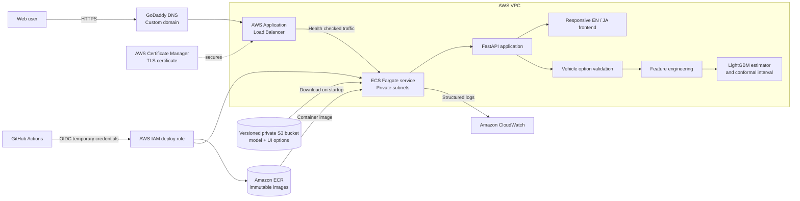
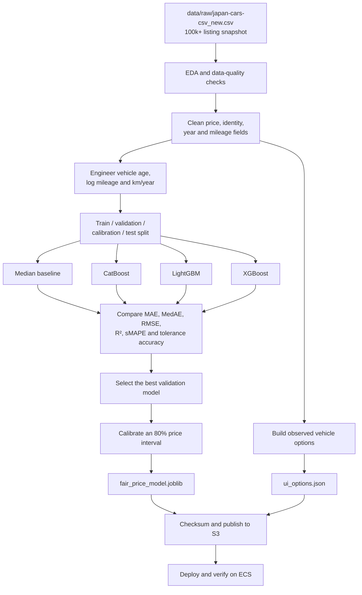
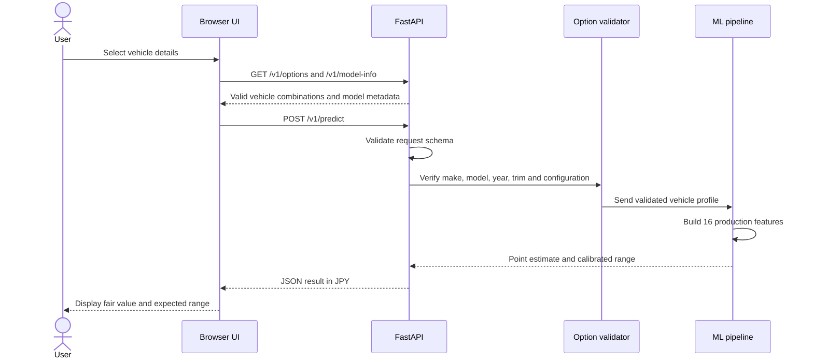

# Japanese Used-Car Fair Value

Production-oriented machine learning application for estimating the advertised price of used cars in Japan. The service turns vehicle details into a fair-value estimate, an 80% calibrated price range, and a validated bilingual user experience.

[](https://github.com/Mohamed1-2/Japanese-Used-Car-Price-Prediction/actions/workflows/ci.yml)


**Live application:** [used-cars.mohammedaldoufani.com](https://used-cars.mohammedaldoufani.com)

## What the application does

A visitor selects a manufacturer, model, registration year, trim, fuel type, transmission, drivetrain, mileage, repair history, and prefecture. The application then:

1. checks that the selected configuration exists in the training-market snapshot;
2. applies the same feature engineering used during training;
3. predicts the vehicle's advertised market price;
4. returns a central estimate and an 80% calibrated price range;
5. presents the result in English or Japanese.

The result is an estimate of an **advertised vehicle price**. Final transaction prices can also depend on condition, optional equipment, dealer fees, negotiation, and local demand.

## Architecture



### Architecture in simple terms

- **The load balancer is the public entrance.** It terminates HTTPS and sends healthy requests to the API.
- **The application runs on ECS Fargate.** AWS runs the container in private subnets, so the task is not directly exposed to the internet.
- **The model is separate from the container image.** Approved model files live in a private, versioned S3 bucket and are downloaded when a task starts.
- **The startup process verifies integrity.** The API checks the model's SHA-256 digest before loading it.
- **GitHub Actions deploys without stored AWS access keys.** GitHub OIDC provides short-lived credentials to a restricted deployment role.
- **CloudWatch receives application logs.** Request IDs, response status, latency, and startup events support production troubleshooting.

## End-to-end project flow



### Online prediction flow



## Machine learning design

### Input data

Both notebooks read the latest local dataset from:

```text
data/raw/japan-cars-csv_new.csv
```

The large raw dataset is kept out of Git. Place it at that path before running the notebooks.

### Features

The production model uses raw and derived signals:

| Group | Examples |
|---|---|
| Vehicle identity | Manufacturer, corporate group, model, trim |
| Age and usage | Registration year, mileage, vehicle age, log mileage, kilometres per year |
| Configuration | Fuel, transmission, gear count, manual mode, drivetrain |
| Context | Repair history and prefecture |

Manufacturer names are normalized while Mercedes-Benz, Mercedes-AMG, and Mercedes-Maybach remain distinct market marques. The same transformations are shared by training and inference to reduce training-serving skew.

### Model selection and uncertainty

The training notebook evaluates a median baseline, CatBoost, LightGBM, and XGBoost. It selects the candidate with the lowest validation MAE, then evaluates that selected model once on the held-out test set. The current exported artifact identifies **LightGBM** as the selected estimator.

The target is trained in `log1p` price space to reduce the influence of very expensive listings. A separate calibration split produces a conformal width in log-price space. At inference time, the service converts the point prediction and interval bounds back to Japanese yen.

Model quality is assessed with multiple regression metrics because no single score represents production quality:

- MAE and median absolute error in JPY;
- RMSE for larger misses;
- R² for explained variation;
- sMAPE for relative error;
- percentage of predictions within ±10% and ±20%;
- interval coverage and errors by source, manufacturer, price band, and age band.

## Product safeguards

The UI does not accept arbitrary vehicle configurations. `ui_options.json` is generated from eligible rows in the training snapshot and stores valid combinations by:

```text
manufacturer → model → registration year → trim → fuel / transmission / drivetrain
```

The browser uses this hierarchy to update each dropdown. The API repeats the validation before prediction, so a manually crafted request cannot bypass the product rules. Pydantic also rejects unknown fields, blank required text, negative mileage, and out-of-range numerical values.

Additional production controls include:

- model schema validation during startup;
- model SHA-256 verification;
- versioned S3 artifacts and immutable ECR image tags;
- health checks at the container, target group, and deployment levels;
- ECS deployment rollback and CPU-based autoscaling;
- structured errors with request IDs;
- unit and integration tests in CI.

## Technology stack

| Layer | Technology |
|---|---|
| Data and modelling | pandas, NumPy, scikit-learn, CatBoost, LightGBM, XGBoost |
| Experimentation | Jupyter, Matplotlib, Seaborn, Plotly |
| Backend | FastAPI, Pydantic, Uvicorn |
| Frontend | HTML, CSS, JavaScript, responsive English/Japanese interface |
| Packaging | Docker, Docker Compose |
| Cloud | AWS ECS Fargate, ECR, S3, ALB, ACM, CloudWatch, IAM |
| Infrastructure | Terraform |
| CI/CD | GitHub Actions, GitHub OIDC |
| Testing | pytest, FastAPI TestClient |

## Repository map

```text
ML_Project/
├── .github/workflows/
│   ├── ci.yml                         # tests, image build and Terraform validation
│   └── deploy-aws.yml                 # OIDC deployment to ECR and ECS
├── app/
│   ├── static/                        # bilingual production web interface
│   ├── bootstrap.py                   # downloads and verifies S3 artifacts
│   ├── main.py                        # FastAPI routes and error handling
│   └── schemas.py                     # request and response contracts
├── data/raw/
│   └── japan-cars-csv_new.csv         # local listing snapshot, ignored by Git
├── infra/terraform/                    # AWS network, storage, IAM and ECS resources
├── notebook/
│   ├── 01_used_car_fair_price_EDA.ipynb
│   ├── 02_used_car_fair_price_model_training.ipynb
│   └── artifacts/                     # generated model and option artifacts
├── scripts/
│   ├── build_ui_options.py            # builds valid UI combinations
│   └── publish_model_artifacts.py      # verifies and uploads approved artifacts
├── src/
│   ├── pipeline/fair_price_inference.py
│   └── ui_options.py                  # option generation and API validation
├── tests/                              # API, inference, bootstrap and option tests
├── Dockerfile
├── compose.yaml
└── requirements*.txt
```

## Run locally

### 1. Create the environment

```bash
git clone https://github.com/Mohamed1-2/Japanese-Used-Car-Price-Prediction.git
cd Japanese-Used-Car-Price-Prediction

python3.11 -m venv .venv
source .venv/bin/activate
python -m pip install --upgrade pip
pip install -r requirements-dev.txt
```

### 2. Add or create the artifacts

To reproduce the analysis, place the current dataset at `data/raw/japan-cars-csv_new.csv`, then run:

1. `notebook/01_used_car_fair_price_EDA.ipynb`
2. `notebook/02_used_car_fair_price_model_training.ipynb`

The training notebook exports:

```text
notebook/artifacts/fair_price_model.joblib
notebook/artifacts/ui_options.json
```

If only the option metadata needs rebuilding:

```bash
python scripts/build_ui_options.py
```

### 3. Start the application

```bash
MPLCONFIGDIR=/tmp/fairvalue-matplotlib \
MODEL_PATH=notebook/artifacts/fair_price_model.joblib \
UI_OPTIONS_PATH=notebook/artifacts/ui_options.json \
uvicorn app.main:app --reload
```

Open:

- Web application: [http://127.0.0.1:8000](http://127.0.0.1:8000)
- OpenAPI documentation: [http://127.0.0.1:8000/docs](http://127.0.0.1:8000/docs)
- Health endpoint: [http://127.0.0.1:8000/health](http://127.0.0.1:8000/health)

### Run with Docker

Docker Compose mounts the local artifacts read-only:

```bash
docker compose up --build
```

## API

| Method | Endpoint | Purpose |
|---|---|---|
| `GET` | `/health` | Readiness, environment and application version |
| `GET` | `/v1/model-info` | Safe model metadata and artifact digest |
| `GET` | `/v1/options` | Valid vehicle combinations for the UI |
| `POST` | `/v1/predict` | Validate a vehicle and return its price estimate |

Example request:

```bash
curl -X POST http://127.0.0.1:8000/v1/predict \
  -H 'Content-Type: application/json' \
  -d '{
    "manufacturer": "トヨタ",
    "model": "アルファード",
    "registration_year": 2021,
    "mileage_km": 42000,
    "trim": "2.5 S",
    "fuel": "ガソリン",
    "transmission": "インパネCVT",
    "drivetrain": "2WD",
    "repair_history": false,
    "prefecture": "東京都"
  }'
```

Example response shape:

```json
{
  "estimated_fair_price_jpy": 4123993,
  "expected_range_low_jpy": 3329168,
  "expected_range_high_jpy": 5108579,
  "target_interval_coverage": 0.8,
  "model_reference_year": 2026,
  "valuation_basis": "advertised_vehicle_price"
}
```

The values above are produced by the current local artifact and will change when a newer model is promoted.

## Test and quality checks

```bash
pytest -q
python -m compileall -q app src tests
terraform -chdir=infra/terraform fmt -check -recursive
terraform -chdir=infra/terraform init -backend=false
terraform -chdir=infra/terraform validate
docker build -t fair-price-api:local .
```

GitHub Actions runs these checks for pull requests and pushes to `main`.

## AWS deployment flow

### Infrastructure provisioning

Terraform creates the VPC, public and private subnets, NAT gateway, security groups, Application Load Balancer, ECS cluster and service, autoscaling, CloudWatch logs, private S3 artifact bucket, ECR repository, and IAM roles.

```bash
cd infra/terraform
cp terraform.tfvars.example terraform.tfvars
terraform init
terraform plan -out=tfplan
terraform apply tfplan
```

Keep `terraform.tfvars`, state files, and plan files local. They are ignored by Git.

### Model promotion

Upload only the model whose digest was reviewed and approved:

```bash
export AWS_PROFILE=mlops

python scripts/publish_model_artifacts.py \
  --bucket "$(terraform -chdir=infra/terraform output -raw artifact_bucket)" \
  --expected-model-sha256 '<approved-model-sha256>'
```

The script verifies the local digest before uploading the model and UI options with server-side encryption and SHA-256 metadata.

### Application deployment

The manually triggered `Deploy API to AWS` workflow:

1. exchanges GitHub's OIDC token for temporary AWS credentials;
2. builds an image tagged with the Git commit SHA;
3. pushes the immutable image to ECR;
4. renders a new ECS task definition revision;
5. deploys the task and waits for service stability;
6. verifies the public HTTPS health endpoint.

This creates a traceable path from Git commit to container image, ECS task revision, model digest, and production health check.

## Production considerations

- Retrain on fresh listings because vehicle prices and market inventory change over time.
- Track point-error metrics and interval coverage by manufacturer, vehicle age, and price band.
- Compare later predictions with outcomes that represent the actual business target when completed-sale data becomes available.
- Promote model artifacts only after held-out, segment, and time-based validation.
- Load serialized model files only from trusted storage.

## Portfolio summary

Built an end-to-end MLOps application that converts more than 100,000 Japanese used-car listings into a bilingual fair-value service. The project covers exploratory analysis, feature engineering, multi-model benchmarking, conformal uncertainty intervals, strict vehicle configuration validation, a versioned FastAPI contract, containerization, Terraform infrastructure, keyless GitHub Actions deployment, and production hosting on AWS ECS Fargate with HTTPS, autoscaling, monitoring, and verified model artifacts.
